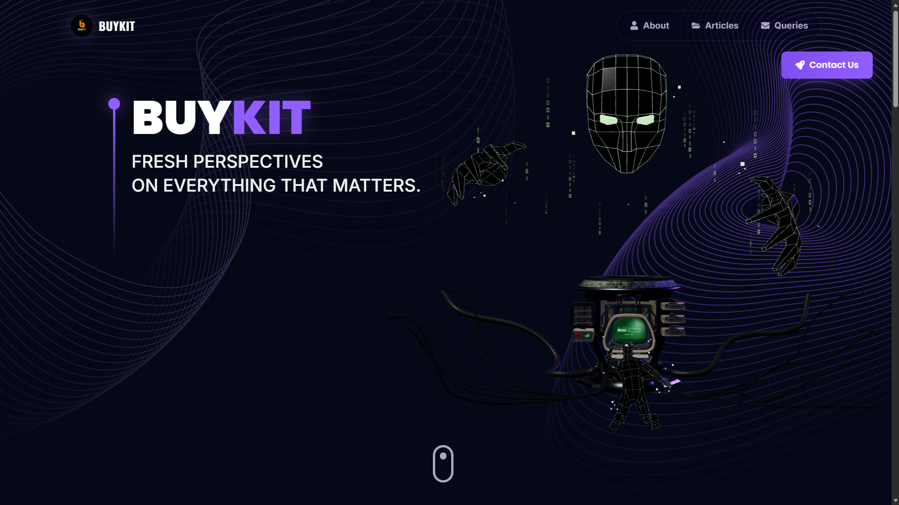
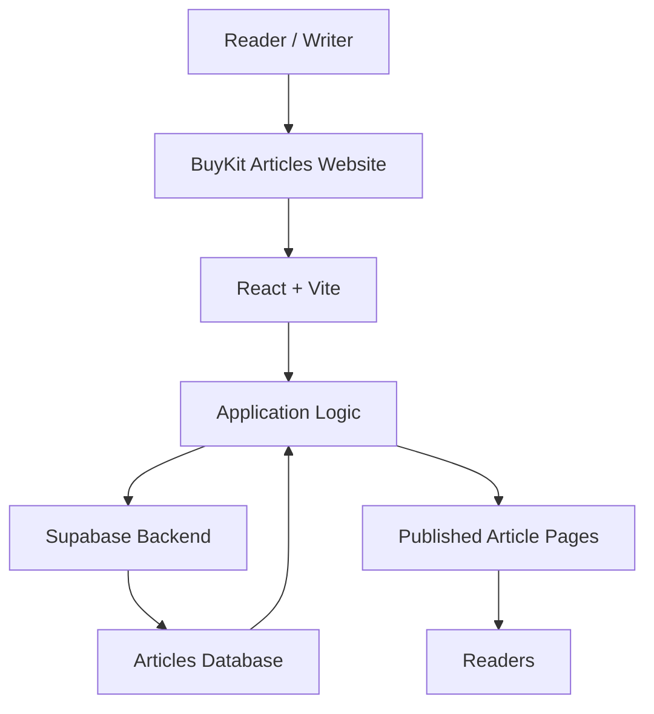
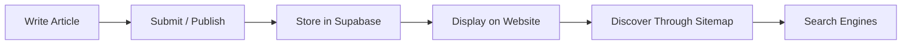
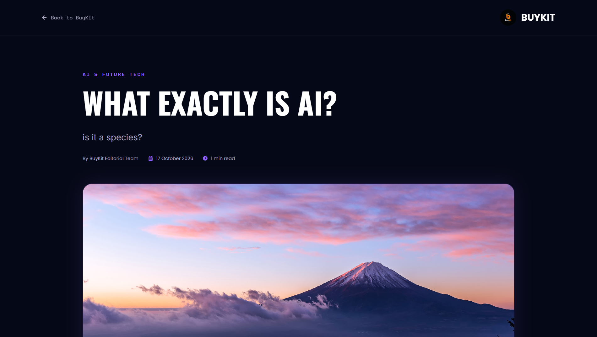
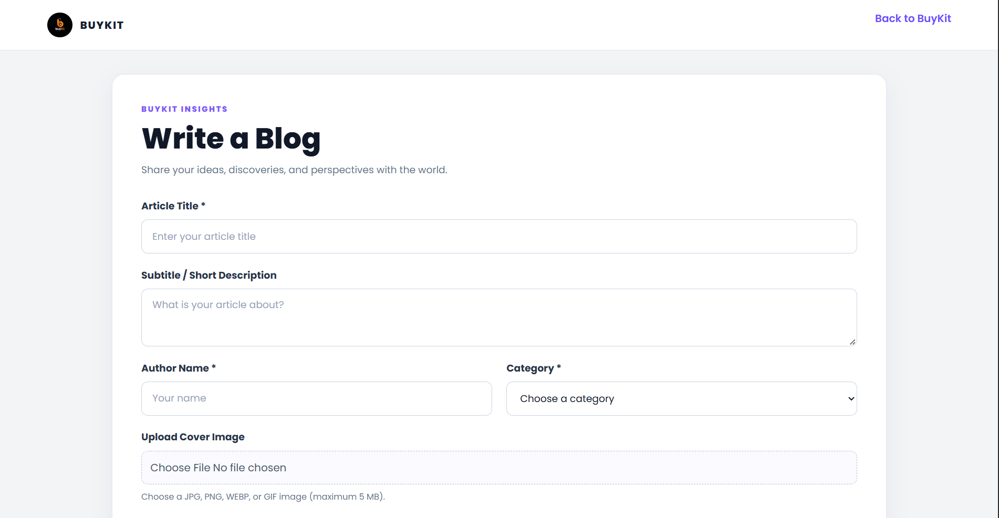

 <div align="center">


# BUYKIT ARTICLES

### FRESH PERSPECTIVES. ON EVERYTHING THAT MATTERS.


**A modern article publishing platform built to make sharing knowledge simple.**

[](https://articles.buykit.in/)
[](https://react.dev/)
[](https://vite.dev/)
[](https://supabase.com/)

[Explore Website](https://articles.buykit.in/) • [Report an Issue](../../issues) • [Contribute](../../pulls)

</div>

---

## About The Project

**BuyKit Articles** is a web-based article publishing platform developed under the BuyKit ecosystem.

The platform aims to provide a simple and accessible space where ideas, knowledge, opinions, and perspectives can be shared through well-written articles.

From technology and artificial intelligence to everyday discoveries, BuyKit Articles focuses on making informative content accessible to readers.

Our vision is to build a growing content platform where writers can share their knowledge and readers can discover something new.

## Preview

<div align="center">




*BuyKit Articles — Homepage*

</div>

## Features

| Feature | Description |
|---|---|
| Article Publishing | Create and publish articles through the publishing system. |
| Dynamic Article Pages | Every article has its own dedicated URL. |
| Content Management | Manage published content through the backend. |
| Responsive Interface | Designed for a modern browsing experience. |
| Database Integration | Supabase-powered data storage. |
| XML Sitemap | Helps search engines discover published content. |
| SEO Foundation | Search-engine-friendly article URLs and sitemap support. |

## Technology Stack

BuyKit Articles uses modern web technologies to provide a fast and maintainable publishing experience.

<div align="center">

| Technology | Purpose |
|---|---|
| React | Frontend interface |
| Vite | Development and build tooling |
| JavaScript | Application logic |
| Supabase | Backend and database |
| React Router | Client-side navigation |
| Vercel | Website deployment |

</div>

### Technology Overview

<div align="center">


</div>

## How It Works

The platform follows a frontend-to-backend architecture.



### Publishing Workflow



## Project Structure

The project follows a typical React and Vite application structure.

```text
buykit-articles/
│
├── public/
│   ├── sitemap.xml
│   └── assets/
│
├── src/
│   ├── components/
│   ├── pages/
│   ├── assets/
│   └── ...
│
├── docs/
│   └── images/
│
├── index.html
├── package.json
├── vite.config.js
└── README.md
```

*The structure above is illustrative. Actual folders may differ depending on the current implementation.*

## Getting Started

Want to explore the project or run it locally? Follow these instructions.

### Prerequisites

Make sure you have installed:

- [Node.js](https://nodejs.org/)
- npm
- [Git](https://git-scm.com/)
- A Supabase project with the required database configuration.

### 1. Clone the Repository

```bash
git clone https://github.com/UJJAWAL07-dev/buykit-blog.git
```

### 2. Navigate to the Project

```bash
cd YOUR_REPOSITORY
```

### 3. Install Dependencies

```bash
npm install
```

### 4. Configure Environment Variables

Create a `.env.local` file in the project root.

Add the Supabase credentials expected by your application.

For a typical Vite Supabase setup:

```env
VITE_SUPABASE_URL=your_supabase_project_url
VITE_SUPABASE_ANON_KEY=your_supabase_anon_key
```

Use the actual environment variable names required by the existing source code.

**Security:** Never expose Supabase service-role keys, database passwords, or other private credentials in frontend code or public repositories.

### 5. Start the Development Server

```bash
npm run dev
```

Open the local URL displayed in your terminal to explore the application.

## Screenshots

A closer look at the platform.

<div align="center">


**Homepage**



**Article Reading Experience**



**Article Publishing Interface**

</div>

*Screenshots can be added to the `docs/images/` directory.*

## Future Roadmap

We believe BuyKit Articles can grow into more than just a publishing website.

Our planned improvements include:

- [ ] Multi-author registration and authentication.
- [ ] Individual writer profiles.
- [ ] Admin-controlled article approval system.
- [ ] Improved content discovery and categorization.
- [ ] Enhanced SEO and metadata management.
- [ ] Analytics and readership insights.
- [ ] Improved reading and writing experience.

These are planned improvements and are not necessarily available in the current release.

## Contributing

We welcome ideas, suggestions, and contributions that can make BuyKit Articles better.

If you are interested in contributing:

1. Fork the repository.
2. Create a new branch.
3. Make your changes.
4. Test your implementation.
5. Submit a Pull Request.

Please open an issue before making major changes so that the proposed improvements can be discussed.

## Part of the BuyKit Ecosystem

BuyKit Articles is part of **BuyKit**, an evolving digital platform focused on useful tools, technology, ideas, and information.

Visit the main website:

**[https://buykit.in](https://buykit.in)**

Explore the article platform:

**[https://articles.buykit.in](https://articles.buykit.in)**

---

<div align="center">

### BUYKIT ARTICLES

**Ideas deserve to be shared.**

Built with curiosity, creativity, and technology.

[Website](https://articles.buykit.in/) · [BuyKit](https://buykit.in/)

</div>